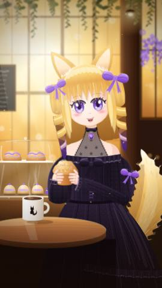

# Golden Hour Fox Girl

A fox girl with golden drill curls and violet eyes, holding a muffin in a sunlit café, painted entirely in SVG code. About 1,300 shapes, no image files.



## What she does

- Blinks (sometimes twice), sways her head, twitches her ears and swishes her tail
- Steam rises from the mug and dust floats in the sunlight
- **Tap her:** happy ^^ eyes, a fast tail wag and a little purple heart

Motion is turned off for anyone who has "reduce motion" set on their device.

## Look at her

Run `python3 gen.py`, then open the `index.html` it writes in any browser. No dependencies beyond Python 3.

## How she's made

`gen.py` writes the whole picture. It's plain Python with no libraries.

- Three stacked SVG layers share one `0 0 810 1440` canvas: a blurred café background, the girl and table, and a light/dust overlay on top.
- The face, eyes, bangs, bows and dress are hand-written paths.
- The drill curls are a tapering helix. The code splits it into front and back half-turns and blends gold into purple toward the tips.
- The tail fur, muffin crumbs, foliage, light spots and dust are placed by a seeded random generator, so every run gives the same picture.
- The animations are plain CSS keyframes. A few lines of JavaScript handle the tap reaction.

Build her page (writes `index.html`, then open it in any browser):

```bash
python3 gen.py
```

Add `--fragment` to write the page body only, the way the Claude artifact host expects it.

## Tools

The `tools/` folder has the Playwright scripts used to check the drawing while it was made. They need Node and Playwright.

- `shot.js` renders the painting, or a crop of it, to PNG
- `frame_at.js` freezes every animation at a chosen millisecond (handy for checking the blink)
- `pagecheck.js` checks the page layout at desktop and phone sizes
